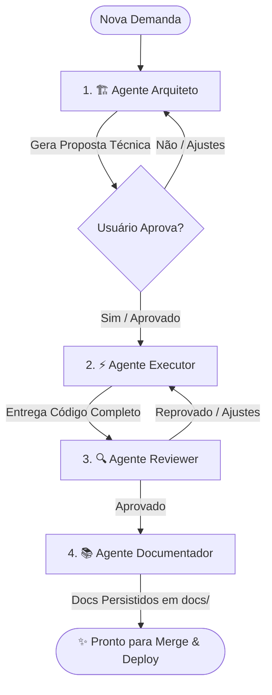

# 🤖 Agentes Especialistas & Skills - Stack Kotlin / Ktor + Vue 3

Este diretório contém a suíte de agentes especialistas e skills de engenharia de software configurados especificamente para a stack **Kotlin (2.x) + Ktor (3.x)**, Clean Architecture, Exposed ORM, Flyway, PostgreSQL, Redis e frontend Vue 3.

---

## 👥 Agentes Disponíveis

| Agente | Arquivo | Função Principal |
| :--- | :--- | :--- |
| **🏗️ Agente Arquiteto** | [`AGENTE_ARQUITETO.md`](./AGENTE_ARQUITETO.md) | Analisa demandas, planeja o modelo de dados (Exposed), migrações Flyway, rotas REST (Ktor 3.x), use cases, corrotinas/jobs assíncronos e interfaces Vue 3. **Bloqueia execução até aprovação.** |
| **⚡ Agente Executor** | [`AGENTE_EXECUTOR.md`](./AGENTE_EXECUTOR.md) | Escreve código de produção 100% completo, tipado, modular e funcional em Kotlin 2.x, Ktor, Exposed e Vue 3, sem omissões nem placeholders. |
| **🔍 Agente Reviewer** | [`AGENTE_REVIEWER.md`](./AGENTE_REVIEWER.md) | Audita segurança (OWASP), structured concurrency/corrotinas, prevenção N+1 no Exposed, tratamento de exceções (StatusPages) e boas práticas antes do merge. |
| **📚 Agente Documentador** | [`AGENTE_DOCUMENTADOR.md`](./AGENTE_DOCUMENTADOR.md) | Gera e mantém a documentação técnica, KDoc, catálogo de endpoints REST (Ktor), schemas de DTOs e documentações no diretório `docs/`. |

---

## 📐 Skills Disponíveis

- **`kotlin-ktor-architecture`** ([`skills/kotlin-ktor-architecture/SKILL.md`](./skills/kotlin-ktor-architecture/SKILL.md)): Padrões arquiteturais para Clean Architecture em Kotlin 2.x, Ktor 3.x (Plugins, StatusPages, ContentNegotiation), Coroutines & Structured Concurrency, Exposed ORM, HikariCP, Flyway, AES-256-GCM, Vue 3 e regras rígidas de isolamento de banco em testes.

---

## ⚡ Regras de Ouro Ktor 3.x
1. **Configurações:** Use SEMPRE `src/main/resources/application.conf` (HOCON nativo do Ktor 3 com `${?VAR}`).
2. **Koin em Rotas:** Use `val useCase by koinInject<T>()` em vez do método legado `Route.inject<T>()`.
3. **Serialização:** NUNCA responda rotas com `mapOf<String, Any>`. Use SEMPRE `data class` anotadas com `@Serializable`.
4. **Imports:** Sempre importe `io.ktor.server.routing.*` nos arquivos de rotas.

---

## 🔄 Ciclo de Desenvolvimento Recomendado

